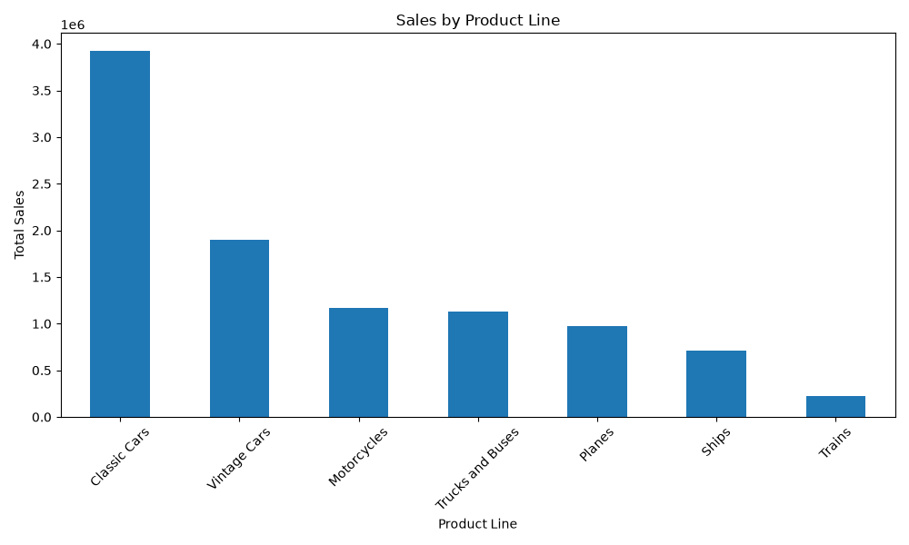
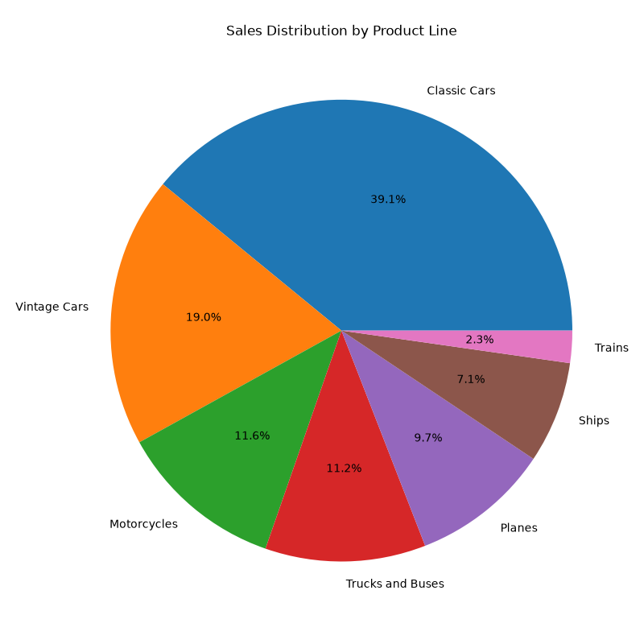
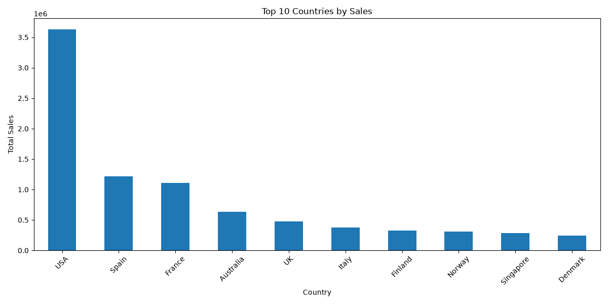

# Sales Analytics

> **Portfolio project** | Exploratory analysis and visualization of a sample sales dataset using Python.

This project analyzes sales by product line and country, summarizes key dataset metrics, and creates charts that make the results easy to explore.

## Project highlights

- Loaded and explored **2,823 sales records** across **25 columns**.
- Summarized total, average, minimum, and maximum sales.
- Compared sales across product lines and countries.
- Generated three charts with pandas and Matplotlib.

## Key findings

| Finding | Result |
| --- | ---: |
| Total sales | 10,032,628.85 |
| Average sales per record | 3,553.89 |
| Top product line | Classic Cars — 3,919,615.66 (39.1%) |
| Top country | USA — 3,627,982.83 |

*Values are shown in the units provided by the sample dataset.*

## Visualizations

### Sales by product line



### Sales distribution by product line



### Top 10 countries by sales



## Tech stack

- Python 3.9+
- pandas
- Matplotlib
- openpyxl

## Run locally

1. Clone this repository and open a terminal in the project directory.
2. Install the dependencies:

   ```bash
   python -m pip install -r requirements.txt
   ```

3. Run the analysis:

   ```bash
   python sales_analaysis.py
   ```

The script reads `sales_data_sample.xlsx`, prints the summaries, and saves the three charts in the project directory. It also opens the charts in interactive windows.

## Project structure

```text
.
├── sales_analaysis.py       # Data exploration, summaries, and chart generation
├── sales_data_sample.xlsx   # Sample sales dataset
├── sales_by_product.png     # Sales by product line
├── sales_distribution.png   # Sales share by product line
└── top_countries.png        # Sales for the top 10 countries
```

## Skills demonstrated

Data loading and inspection · Aggregation with pandas · Descriptive statistics · Data visualization · Communicating findings
